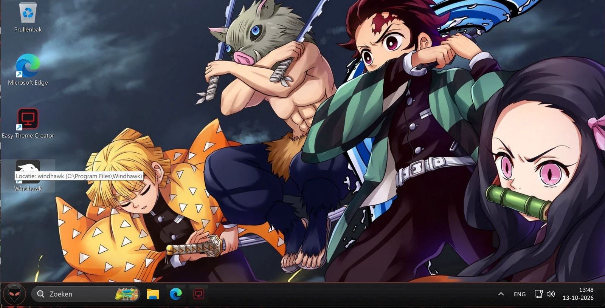
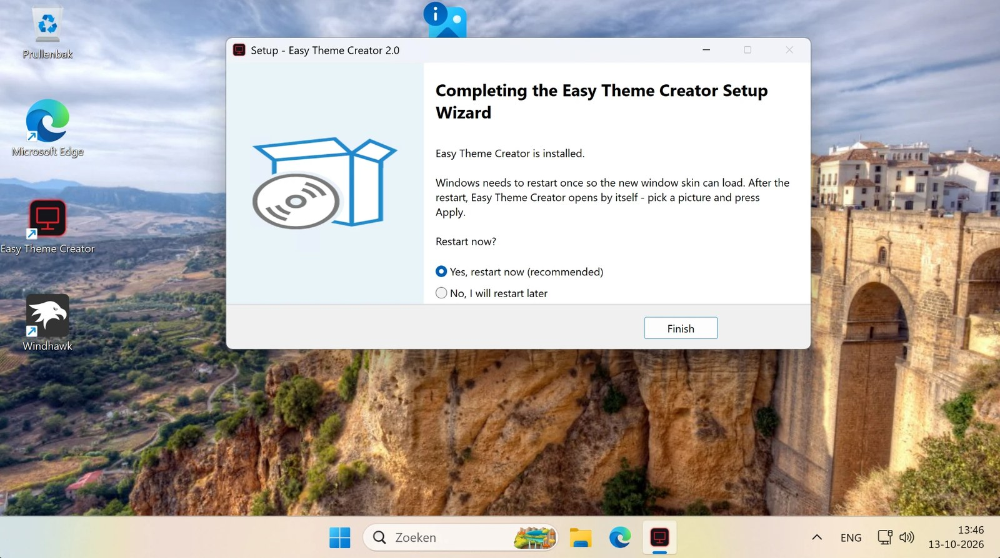
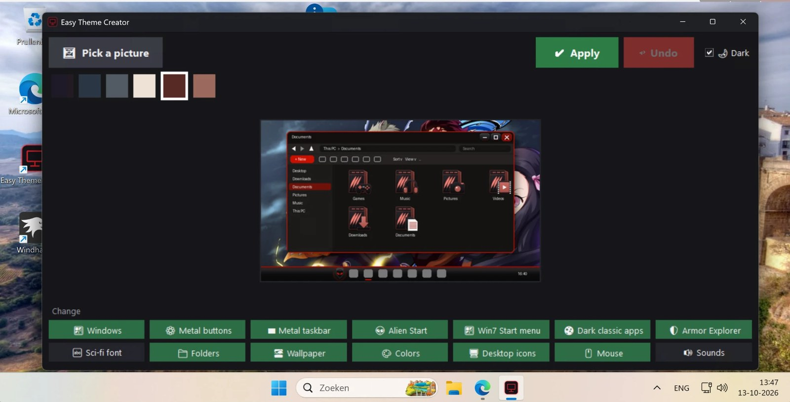
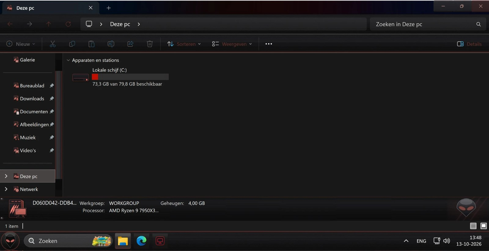
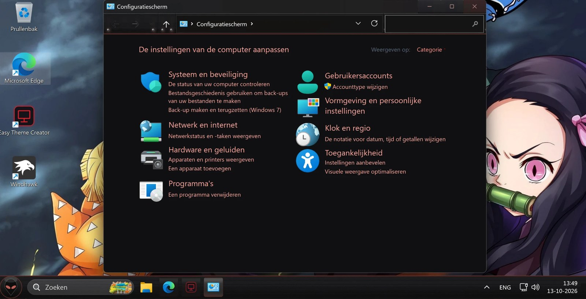
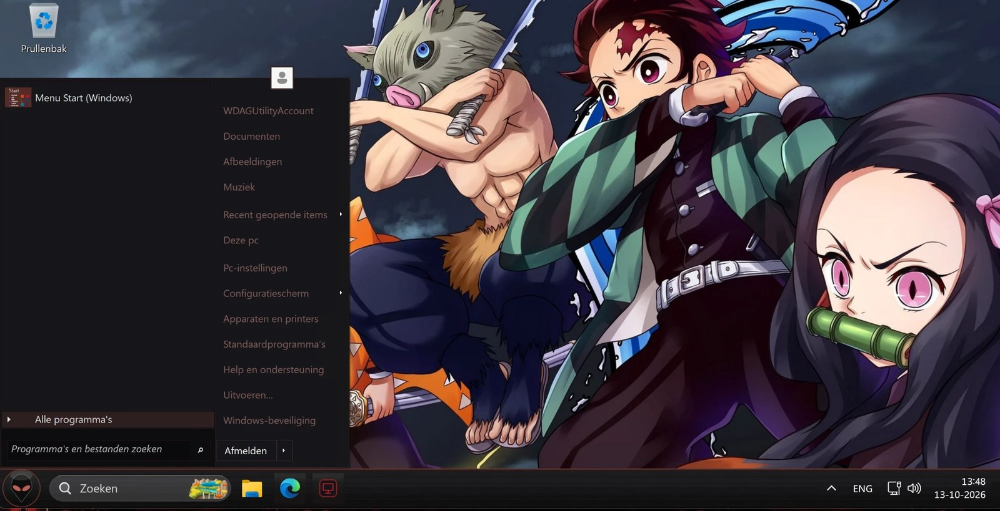
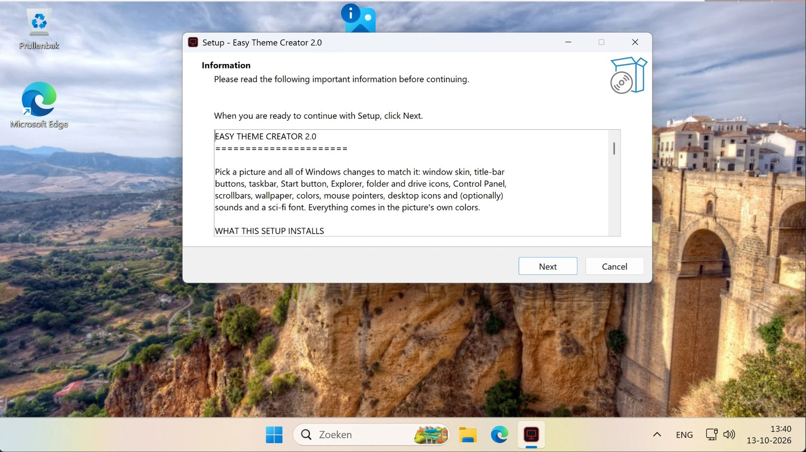
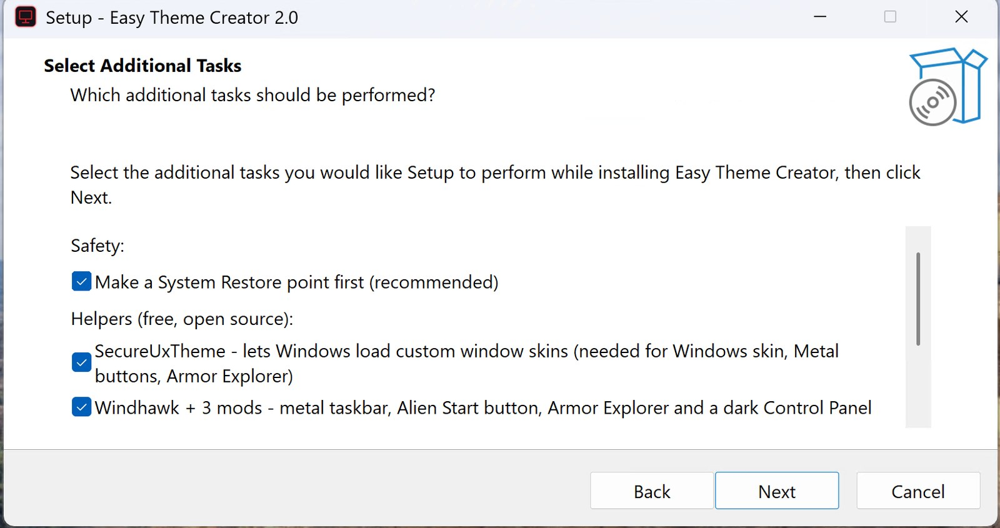
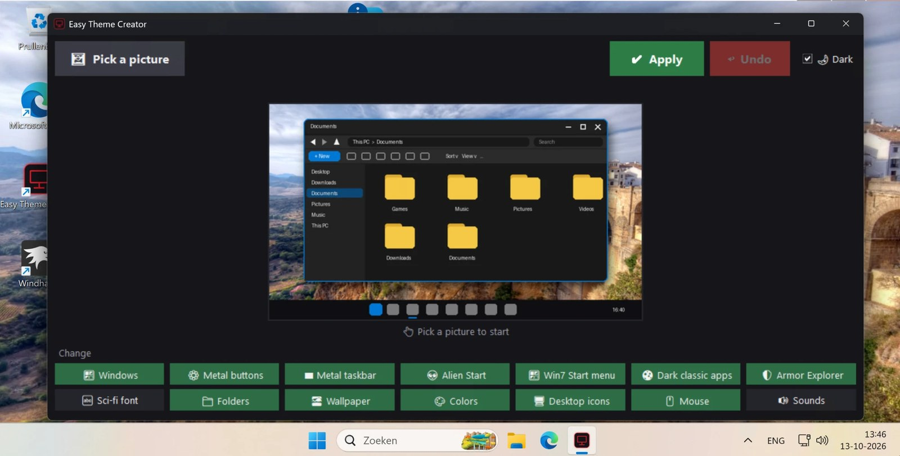

# Easy Theme Creator

Pick a picture, press **Apply**, and all of Windows 11 changes to match it: window skin, taskbar, Start button and Start menu, Explorer, Control Panel, folder and drive icons, wallpaper, colours, mouse pointers and desktop icons. One picture, one click, one theme. Press **Undo** and everything is back the way it was.

Everything it uses is free and open source. Nothing to buy, no trials.



## Download

**[Easy Theme Creator Setup.exe](https://github.com/tbrains1998-web/Easy-Theme-Creator/releases/latest)** (43 MB, Windows 11 64-bit)

Windows may say *"Windows protected your PC"* because the setup isn't signed. Click **More info**, then **Run anyway**. The setup makes a System Restore point first if you leave that box ticked.

## First time

1. Run the setup. Leave the helpers ticked (see [What gets installed](#what-gets-installed)).
2. The last page asks for **one restart**. Say yes. After the restart, Easy Theme Creator opens by itself.

   

3. Click **Pick a picture** and choose any photo or wallpaper you like.
4. The app picks the picture's colours; click the one you want as the accent (right-click a colour to change it).
5. Green buttons at the bottom are the parts that will change. Click any to switch it off.
6. Press **Apply**. The screen blinks while Explorer restarts, and the theme is on.



## What it changes

| Button | What it does |
|---|---|
| **Windows** | A dark window skin in your picture's colours (menus, dialogs, buttons, scrollbars) |
| **Metal buttons** | Brushed-metal title-bar buttons |
| **Metal taskbar** | A Windows 7-style metal taskbar with icons on the left |
| **Alien Start** | An alien-head Start button that glows in your accent colour |
| **Win7 Start menu** | The Windows 7 Start menu, in the same armor look |
| **Dark classic apps** | Dark backgrounds, fields and buttons for old-style windows and Control Panel |
| **Armor Explorer** | Riveted metal bars, red buttons and the Windows 7 details panel along the bottom of every folder |
| **Sci-fi font** | The Orbitron font for file names, menus and status bars (off by default: it changes all of Windows and needs a sign-out) |
| **Folders**, **Desktop icons** | Folder, drive, This PC, Recycle Bin and other icons drawn in your colours |
| **Wallpaper**, **Colours**, **Mouse**, **Sounds** | Your picture as wallpaper, Windows accent colours, matching pointers, and (off by default) sounds |







## More pictures

| | |
|---|---|
|  |  |
|  |  |

## A program looks wrong?

Some programs set a few of their own colours (a white text box, say) and take the rest from Windows. With the dark theme those two halves stop matching and the text turns unreadable. Click **Fix an app** next to Undo, then click the window that looks wrong. From its next start that program gets Windows' normal colours and no skin, so it looks the way it was designed, while everything else keeps the theme. The same window lists the programs you've fixed, and Undo clears the list.

## Undo and uninstall

**Undo** puts back exactly how Windows looked before your first Apply, every part of it, however many themes you tried in between.

Uninstalling from **Settings > Apps** does the same Undo first, then removes the app. The helpers (SecureUxTheme, Windhawk, Open-Shell) stay installed; remove them there too if you don't want them any more.

## What gets installed

The setup installs the app with its own private copy of Python, so there is nothing else to install. It also installs three free, open-source helpers, each with its own tick box:

- **[SecureUxTheme](https://github.com/namazso/SecureUxTheme)** by namazso: Windows only loads its own built-in window skins; this lets it load the one the app makes. Needed for *Windows*, *Metal buttons* and *Armor Explorer*. This is the part that needs the one restart.
- **[Windhawk](https://windhawk.net)** by Ramen Software, with three of its mods, all used only inside Explorer: *Windows 11 Taskbar Styler* (the metal taskbar and Start button), *Windows 11 File Explorer Styler* (the armor bars) and *Resource Redirect* (the dark Control Panel pane and the bottom details panel). Easy Theme Creator adds one small mod of its own (source in `installer/windhawk-mod`) for the *Fix an app* feature.
- **[Open-Shell](https://github.com/Open-Shell/Open-Shell-Menu)**, Start menu part only: the Windows 7 Start menu.

Some antivirus programs flag theme patchers like SecureUxTheme. It is a well-known open-source tool; the setup only installs the official release, checked against its hash.

## How it works, in short

The app recolours a copy of Windows' own Aero skin (`aero.msstyles`) into your picture's colours and paints its armor art into it, then asks Windows to use that skin. The taskbar and Explorer looks are pictures and styles handed to Windhawk's stylers. The dark Control Panel pane and the Windows 7 details panel are resources inside `shell32.dll` that Windhawk's Resource Redirect serves from the app's own files, so no Windows file is ever modified. Before the first Apply the app saves everything it is about to touch, which is what Undo restores.

## Building the setup yourself

You need Windows, Python 3.12 with `numpy`, `pillow` and `pefile`, [Inno Setup 6](https://jrsoftware.org/isinfo.php), and Windhawk with the three mods above installed (the compiled mods are copied from your Windhawk). Then:

```
python installer\build.py
```

The script downloads the three helper installers from their official release pages, checks each against the SHA-256 it was verified with, and refuses anything else. The result is `dist\Easy Theme Creator Setup.exe`.

## Credits and licences

Easy Theme Creator is [MIT licensed](LICENSE). It bundles: SecureUxTheme (LGPL-2.1), Windhawk and its mods (GPL-3.0, mod source included), Open-Shell (MIT; the armor Start menu skin is made from its Midnight skin), the Orbitron font by The League of Moveable Type (SIL Open Font License), Python (PSF), NumPy (BSD), Pillow (MIT-CMU) and pefile (MIT). Every licence text ships in the app's `licenses` folder.

Built with Claude Code.
